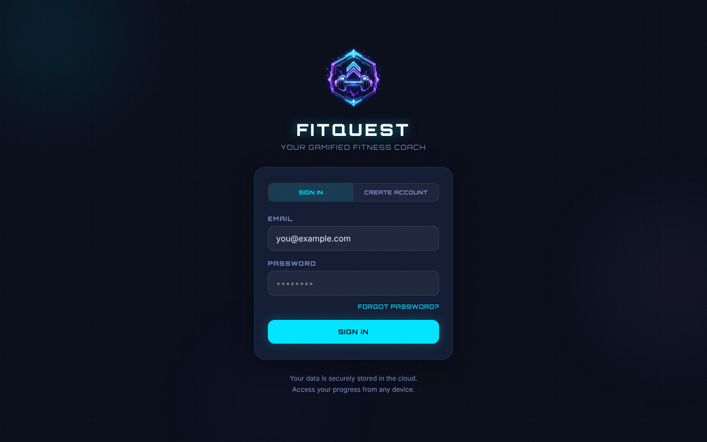
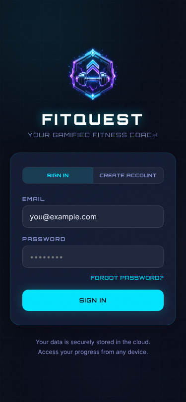
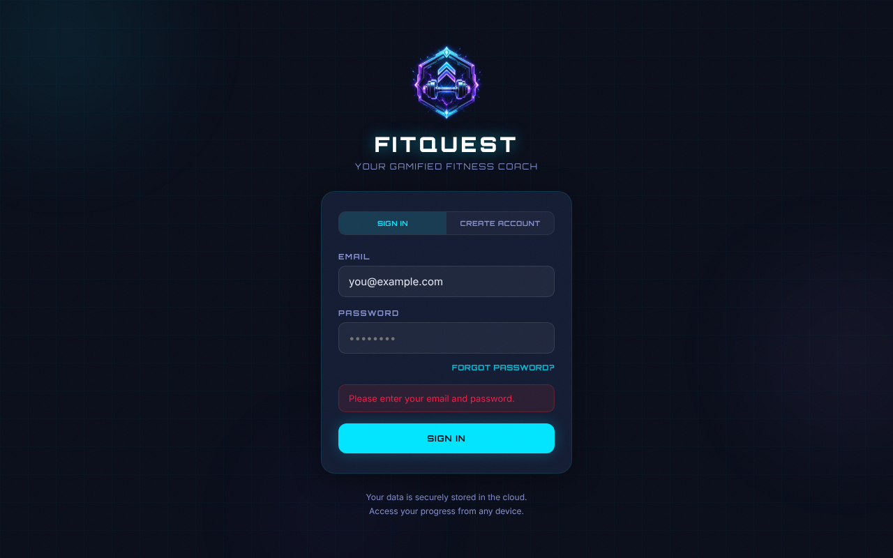
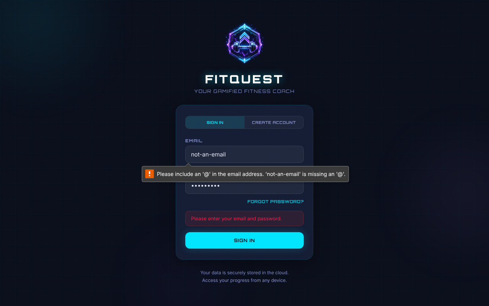
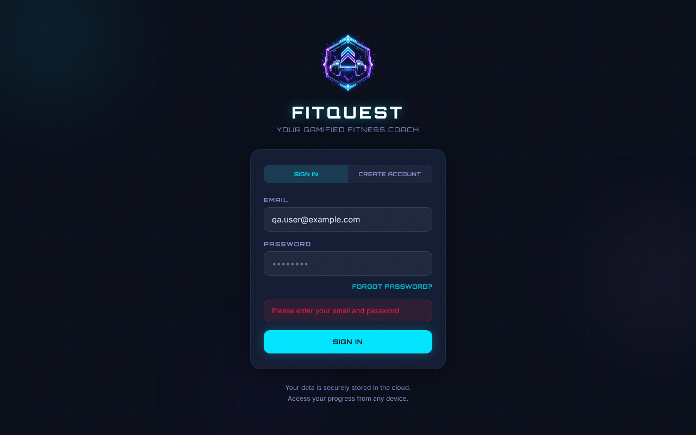
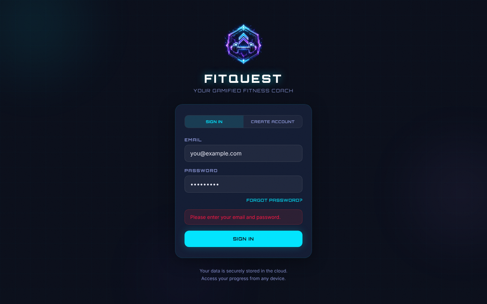
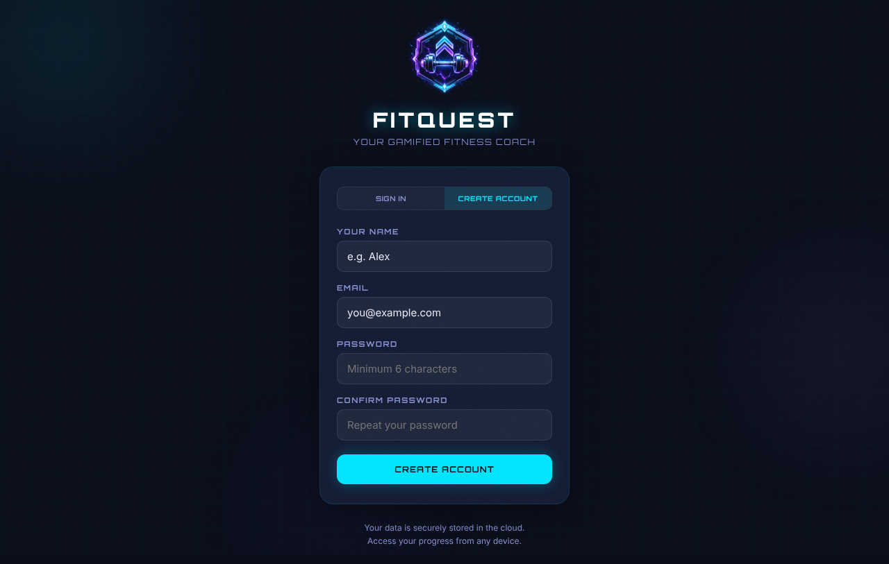
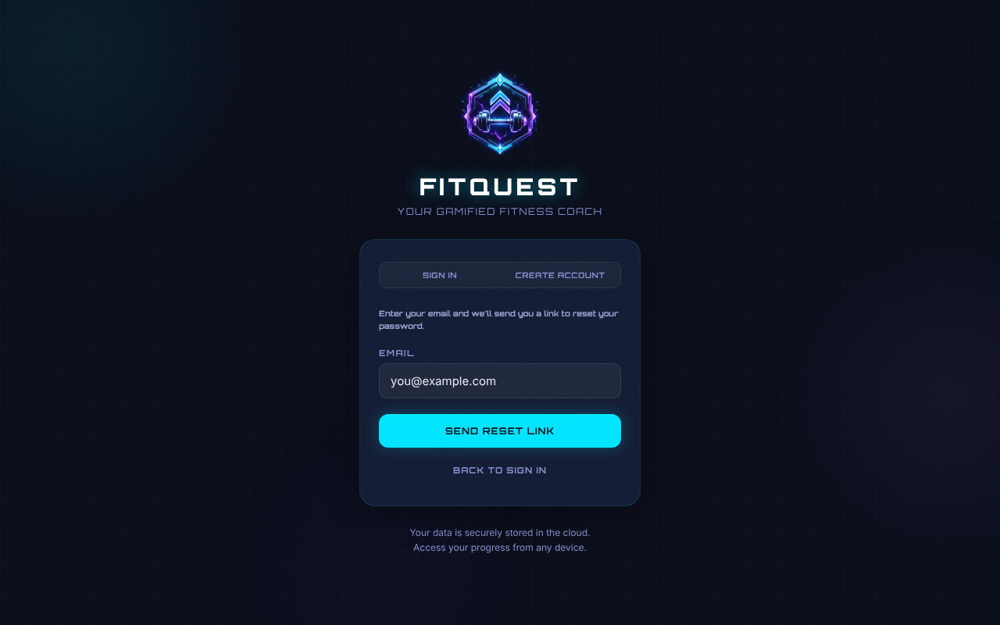
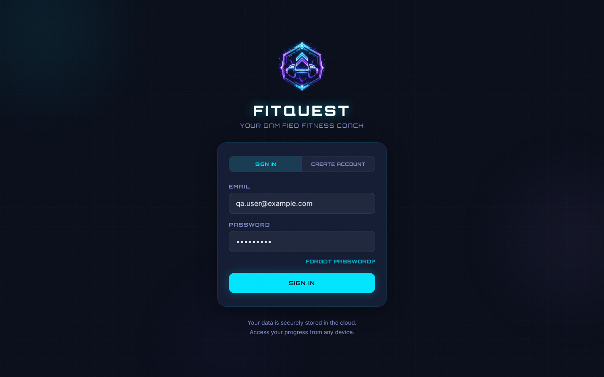

# T10-train-auth-wall-anonymous: Anonymous deep link to the Train tab shows the login wall — Result

| Field | Value |
|---|---|
| Result | PASS |
| Task file | QA-tests/tasks/T10-train-auth-wall-anonymous.md |
| Route | /?tab=train |
| Date (UTC) | 2026-10-24T03:23:52Z |
| Run id | 2026-10-24T03-20-29Z |
| Duration (s) | 27 |
| Role | anonymous |
| Browser engine | playwright |
| Browser channel | chromium |
| Headless | true |
| Screenshots | 15 |
| Console errors | 3 |
| Network failures | 3 |

## Summary
Attempt 2, driven with the Node `playwright` library (chromium, headless, fresh context, no Supabase env). An anonymous visit to `/?tab=train` renders the LoginScreen in place: the URL is unchanged, no Train content, AI Coach button, tab bar or primary nav is in the DOM, and there is no `/api/coach` request. The empty-field validation, native email validation, mode switches and button coverage all behave as specified. `/?tab=TRAIN`, `/?tab=bogus` and `/` show the same wall. The dev server serves `/api`: GET returned 500 `{"ok":false}` (no ANTHROPIC_API_KEY), unauthenticated POST returned 401 and PUT returned 405, all as expected. All 3 console errors and 3 network failures come from those deliberate TC-05 probes. Outside the probes there were 0 errors, and the only warning was the allowed missing-Supabase warning. Three minor defects are recorded, none of which fails a TC: the stale app error during native validation (expected finding), the silent sign-in no-op with no Supabase (expected finding), and a newly observed one-frame boot-screen flash on reload (the task's premise that `authLoading` is false immediately is wrong). No Train content ever flashed.

## Test Case Results

### TC-01: Happy path — anonymous Train deep link shows the login wall — PASS
- Step 1-2: fresh context, navigated to `http://localhost:5173/?tab=train`, networkidle + 1000 ms.
- Step 3: `document.title` → `FitQuest — AI-Powered Fitness Training` ✓
- Step 4: URL → `http://localhost:5173/?tab=train` (no redirect) ✓
- Step 5: visible: `FITQUEST`, `YOUR GAMIFIED FITNESS COACH`, toggles `SIGN IN` / `CREATE ACCOUNT`, `EMAIL` (placeholder `you@example.com`), `PASSWORD` (placeholder `••••••••`), `FORGOT PASSWORD?`, submit `SIGN IN`, and both footer lines ✓
- Step 6: no `button[aria-label="Open AI Coach"]`, no `section[aria-label="Today's session"]`, none of `DAILY QUEST` / `START SESSION` / `＋ ADD EXERCISE` / `Recent Sessions` / `Week 1 of 12` ✓
- Step 7: no `nav[aria-label="Primary"]`, 0 `role=tab` elements, no `Signed in as` ✓
- Step 8: exactly 1 `[FitQuest] Missing VITE_SUPABASE_URL or VITE_SUPABASE_ANON_KEY — cloud sync disabled` warning, 0 console errors, 0 page errors ✓
- Step 9: no request to `/api/coach` ✓
- Step 10: at 375×812, `scrollWidth` = 375 and the form box spans x=45 to 330 (fully inside the viewport) ✓
- Assertion: login wall in place, no app shell → actual: as expected.

### TC-02: Form validation — login-signin — PASS
| Field | Case | Expected | Actual | Result |
|---|---|---|---|---|
| email + password | both empty | "Please enter your email and password." | "Please enter your email and password." | ✓ |
| email | `not-an-email` + `Passw0rd!` | native `validationMessage` non-empty | "Please include an '@' in the email address. 'not-an-email' is missing an '@'." Stale app error still visible (finding confirmed) | ✓ |
| password | `qa.user@example.com` + `""` | "Please enter your email and password." | "Please enter your email and password." | ✓ |
| email | `""` + `Passw0rd!` | "Please enter your email and password." | "Please enter your email and password." | ✓ |
- Step 4: after each step the URL was still `/?tab=train` and no Train content appeared ✓
- Note: before rows 3 and 4 the page was reloaded, so the stale error from row 2 could not make those assertions pass falsely.

### TC-03: Modal coverage — n/a, login mode switches instead — PASS
- Step 1: `CREATE ACCOUNT` toggle shows `YOUR NAME` (`e.g. Alex`), `EMAIL`, `PASSWORD` (`Minimum 6 characters`), `CONFIRM PASSWORD` (`Repeat your password`), submit `CREATE ACCOUNT`, and `FORGOT PASSWORD?` is hidden ✓
- Step 2: `SIGN IN` toggle brings back 2 inputs, submit `SIGN IN`, and `FORGOT PASSWORD?` is visible ✓
- Step 3: `FORGOT PASSWORD?` shows 1 input (`EMAIL`), submit `SEND RESET LINK`, and `BACK TO SIGN IN` is visible ✓
- Step 4: `BACK TO SIGN IN` returns to sign-in mode with `PASSWORD` and `FORGOT PASSWORD?` visible ✓
- Step 5: URL was `/?tab=train` after every switch ✓

### TC-04: Button coverage — PASS
| Button | Action | Expected | Actual | Result |
|---|---|---|---|---|
| `SIGN IN` (toggle) | click | stays in sign-in, no error | submit `SIGN IN`, no error box | ✓ |
| `CREATE ACCOUNT` (toggle) | click | sign-up fields appear | `Repeat your password` field present | ✓ |
| `FORGOT PASSWORD?` | click | reset form with `SEND RESET LINK` | submit `SEND RESET LINK` | ✓ |
| `BACK TO SIGN IN` | click | returns to sign-in | submit `SIGN IN` | ✓ |
| `SIGN IN` (submit) | click, both empty | "Please enter your email and password." | "Please enter your email and password." | ✓ |
| `SIGN IN` (submit) | `qa.user@example.com` / `Passw0rd!`, no Supabase | maybe flashes `PLEASE WAIT...`, then `SIGN IN`; no error; still on the wall | label sampled every 20 ms showed only `SIGN IN`, no error text, URL `/?tab=train`, no Train content (silent no-op, DEF-signin-silent-noop-no-supabase) | ✓ |

### TC-05: Negative & edge cases — PASS
- Reload `/?tab=train` ×3: each load ended on the login wall (1 submit button, no Train content). DOM text was sampled every 50 ms from navigation commit, and no Train text (`DAILY QUEST`, `START SESSION`, `Week 1 of 12`) ever appeared. On some loads (1 of 3 in the main run, 1 of 6 in a follow-up probe) the first painted frame was the SyncIndicator boot screen (`SYSTEM ONLINE · FITQUEST · ARISE · TRAIN · LEVEL UP > System online OK > Authenticat…`) before the wall. That screen is not Train content, so the assertion holds. But the task's premise that `authLoading` is false immediately when supabase is null is wrong: `src/hooks/useAuth.js` initializes `loading` to `true` and clears it only inside a `useEffect` (DEF-auth-loading-boot-flash).
- `/?tab=TRAIN` → login wall ✓; `/?tab=bogus` → login wall ✓; `/` → login wall ✓
- `GET /api/coach` → `500` `application/json` `{"ok":false}`, which matches the documented response when ANTHROPIC_API_KEY is unset ✓
- `POST /api/coach` with `{}` and no Authorization → `401` `{"error":"Authentication required"}` (not an Anthropic response) ✓
- `PUT /api/coach` → `405` `{"error":"Method not allowed"}` ✓

## Screenshots

### TC-01

### TC-02

### TC-03

### TC-04

### TC-05

## Console & Network
- console.errors: [http://localhost:5173/api/coach — Failed to load resource: 500 (deliberate TC-05 GET probe), http://localhost:5173/api/coach — Failed to load resource: 401 (deliberate TC-05 POST probe), http://localhost:5173/api/coach — Failed to load resource: 405 (deliberate TC-05 PUT probe)]
- console.warnings: [src/lib/supabaseClient.js:6 — [FitQuest] Missing VITE_SUPABASE_URL or VITE_SUPABASE_ANON_KEY — cloud sync disabled (once per page load; allowed)]
- failedRequests: [{ GET, /api/coach, 500 }, { POST, /api/coach, 401 }, { PUT, /api/coach, 405 }] (all deliberate TC-05 probes; 0 unexpected)

## Defects Found
- DEF-stale-error-native-validation: after an empty submit, entering `not-an-email` and submitting leaves the stale "Please enter your email and password." visible next to the native email tooltip, because native validation stops `handleSubmit` before it clears `localError` (minor UX; expected finding).
- DEF-signin-silent-noop-no-supabase: with Supabase unconfigured, submitting valid credentials does nothing visible: no `PLEASE WAIT...`, no error and no feedback (same as T01 TC-03; expected finding).
- DEF-auth-loading-boot-flash: on a cold load with supabase null, `useAuth` starts with `loading=true` and clears it in an effect, so the SyncIndicator boot screen ("SYSTEM ONLINE … Authenticat…") sometimes paints for one frame before the login wall. Cosmetic; it contradicts the task's premise that `authLoading` is false immediately. No Train content is exposed.
