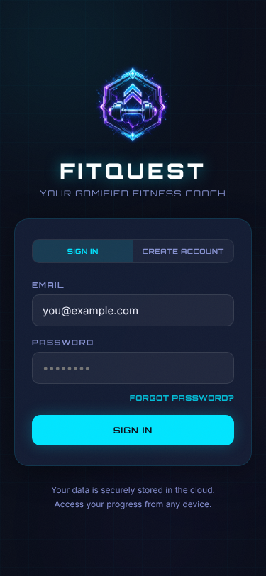
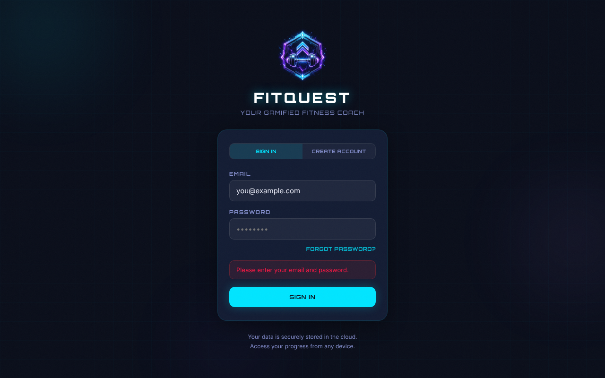
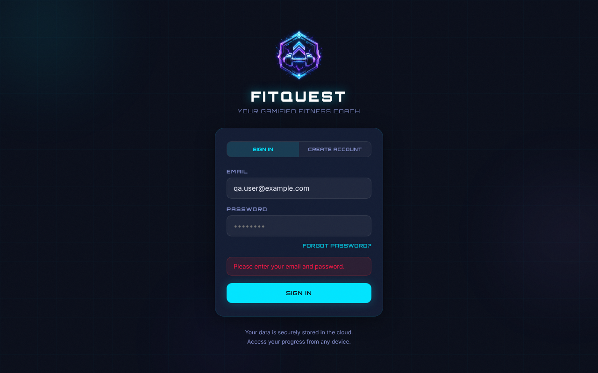
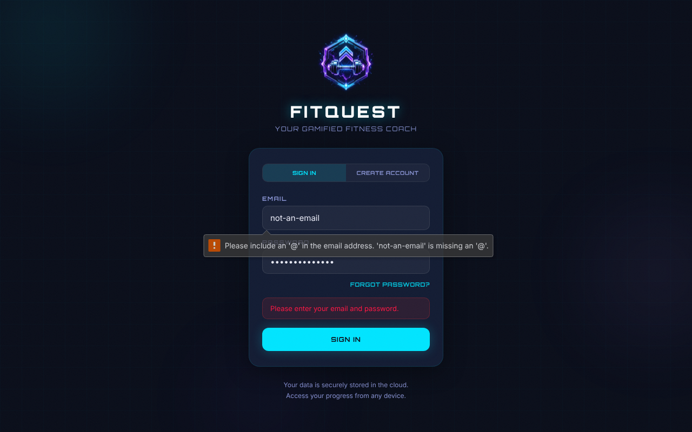
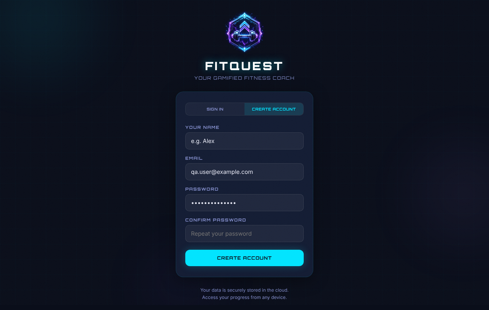
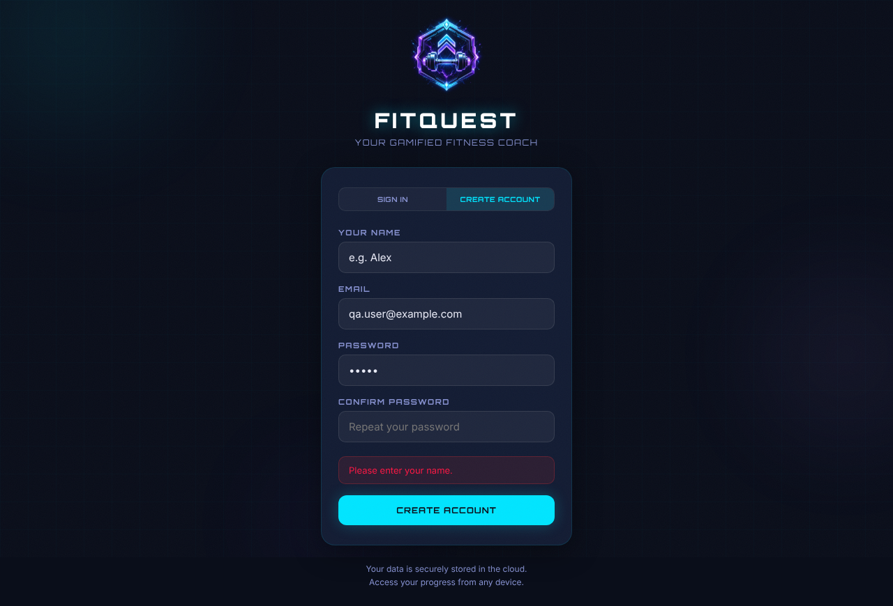
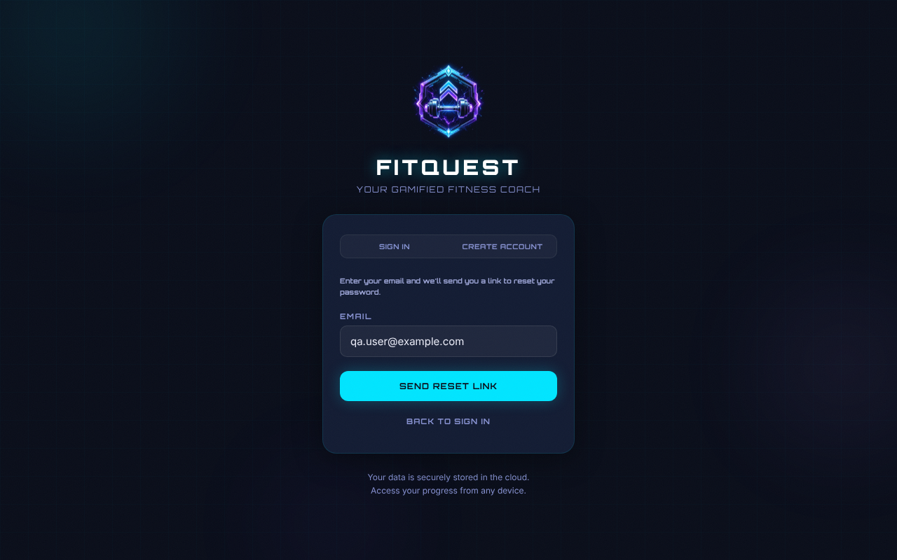
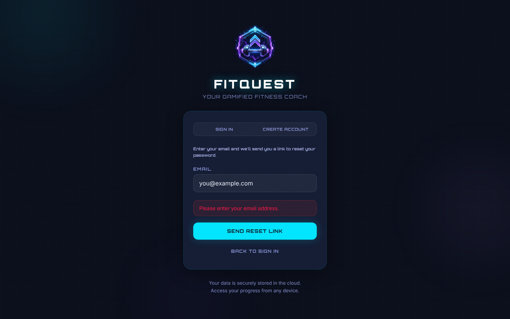
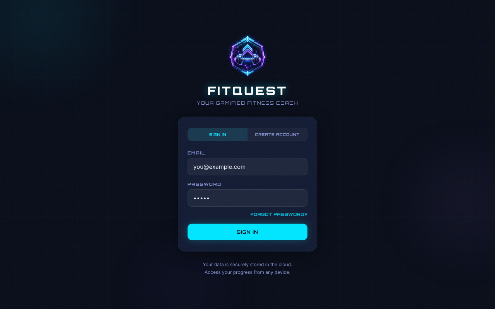
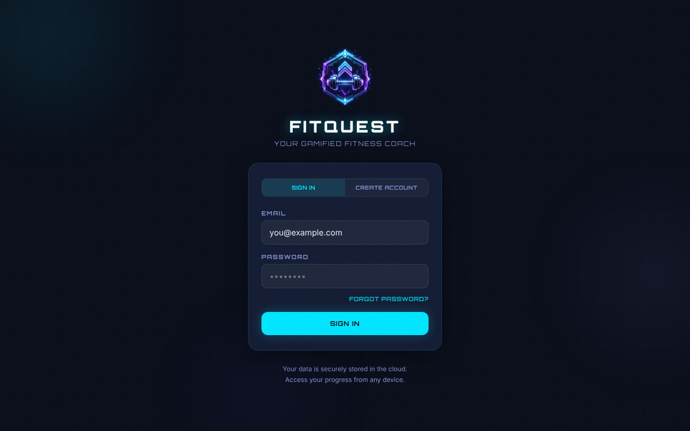

# T20-fuel-auth-wall-anonymous: Anonymous deep link to Fuel tab shows the login wall — Result

| Field | Value |
|---|---|
| Result | PASS |
| Task file | QA-tests/tasks/T20-fuel-auth-wall-anonymous.md |
| Route | /?tab=fuel |
| Date (UTC) | 2026-10-24T03:23:44Z |
| Run id | 2026-10-24T03-20-29Z |
| Duration (s) | 32 |
| Role | anonymous |
| Browser engine | playwright |
| Browser channel | chromium |
| Headless | true |
| Screenshots | 18 |
| Console errors | 3 |
| Network failures | 3 |

## Summary
Attempt 2, driven with the Node `playwright` library (Chromium, headless, fresh context, no Supabase env). All five TCs passed. An anonymous visit to `/?tab=fuel` renders LoginScreen in place: the URL does not change, and no Fuel content, primary nav or tab buttons are in the DOM. The only FitQuest console message is the expected missing-Supabase warning, and no `/api/nutrition` or `/api/usda` request is made. At 375 px there is no horizontal overflow. Every validation message in sign-in, create-account and forgot-password modes matched the task. The task's TC-05 probes returned 401 `Authentication required` for POST nutrition, 405 `Method not allowed` for GET nutrition and 401 for USDA. These three probes are the only source of the 3 console errors ("Failed to load resource") and the 3 network failures in the header, so they are expected and not unexpected errors. Outside TC-05 there were 0 console errors and 0 failed requests. As the task instructs, one UX defect is logged: without Supabase, sign-in (and reset-link) submits fail silently with no feedback.

## Test Case Results

### TC-01: Happy path — anonymous Fuel deep link shows the login wall — PASS
- Step 1-2: Fresh context (1280×800), opened `http://localhost:5173/?tab=fuel`, then waited for network idle plus 1000 ms.
- Step 3: `document.title` = `FitQuest — AI-Powered Fitness Training` ✓
- Step 4: URL = `http://localhost:5173/?tab=fuel`, no redirect ✓
- Step 5: Visible: `FITQUEST`, `YOUR GAMIFIED FITNESS COACH`, `SIGN IN` / `CREATE ACCOUNT` toggles, `EMAIL` (placeholder `you@example.com`), `PASSWORD` (placeholder `••••••••`), `FORGOT PASSWORD?`, submit `SIGN IN`, `Your data is securely stored in the cloud.` / `Access your progress from any device.` ✓
- Step 6: None of these are in the DOM: `FUEL`, `AI-powered nutrition tracking`, `SCAN MEAL`, `Upload from gallery`, `OR ADD MANUALLY`, placeholder `e.g. 2 scrambled eggs`. `svg[role=img][aria-label*="kcal eaten"]` count = 0 ✓
- Step 7: `nav[aria-label="Primary"]` count = 0, Train/Fuel/Progress/Profile buttons = 0, no `Signed in as` ✓
- Step 8: Console shows exactly one FitQuest warning, `[FitQuest] Missing VITE_SUPABASE_URL or VITE_SUPABASE_ANON_KEY — cloud sync disabled`, and 0 errors. The other entries are Vite debug and React DevTools info ✓
- Step 9: Requests to `/api/nutrition` or `/api/usda` = 0 ✓
- Step 10: At 375×812, `scrollWidth` = 375 and the login card rect is x 20→355, y 308→657 (fully inside the viewport) ✓
- Assertion: login wall in place with no Fuel UI → actual: as expected.

### TC-02: Form validation — login-form (sign-in mode) — PASS
| Field | Case | Expected | Actual | Result |
|---|---|---|---|---|
| (toggle) | click mode-toggle SIGN IN | page text unchanged, no error | text identical, no error box | ✓ |
| email+password | both empty → submit | `Please enter your email and password.` | `Please enter your email and password.` | ✓ |
| email | type `qa.user@example.com` (no submit) | error box still visible | still visible | ✓ |
| password | `qa.user@example.com` + empty password → submit | `Please enter your email and password.` | `Please enter your email and password.` | ✓ |
| email | `not-an-email` + `CorrectHorse9!` → submit | non-empty `validationMessage`, no new app error, label `SIGN IN` | `Please include an '@' in the email address. 'not-an-email' is missing an '@'.`; app error box unchanged (stale step-3 message, no new render); label `SIGN IN` | ✓ |
| email+password | `qa.user@example.com` / `CorrectHorse9!` → submit (no Supabase) | label returns to `SIGN IN`, no error box, still on `/?tab=fuel` | label `SIGN IN` (`PLEASE WAIT...` never observed, 20 ms polling), no error box, URL `/?tab=fuel`. Silent failure → DEF-signin-silent-failure-no-supabase | ✓ |

### TC-03: Modal coverage — n/a (login-screen mode switches) — PASS
- Step 1: The CREATE ACCOUNT toggle shows `YOUR NAME` (placeholder `e.g. Alex`, maxLength 30), `EMAIL`, `PASSWORD` (placeholder `Minimum 6 characters`) and `CONFIRM PASSWORD` (placeholder `Repeat your password`). The submit reads `CREATE ACCOUNT` and `FORGOT PASSWORD?` is hidden ✓
- Step 2: Empty submit → `Please enter your email and password.` ✓. Email `qa.user@example.com` + password `abc12` with no name → `Please enter your name.` ✓
- Step 3: Name `QA Tester`, confirm `abc13` → `Passwords do not match.`, and the CONFIRM PASSWORD border is `1px solid rgba(255, 50, 50, 0.5)` (red; PASSWORD keeps `rgba(255,255,255,0.1)`) ✓. With both set to `abc12` → `Password must be at least 6 characters.` ✓
- Step 4: The toggle `SIGN IN` clears the error box (none rendered) ✓
- Step 5: `FORGOT PASSWORD?` shows `Enter your email and we'll send you a link to reset your password.`, `SEND RESET LINK` and `BACK TO SIGN IN` ✓. Empty submit → `Please enter your email address.` ✓
- Step 6: `BACK TO SIGN IN` returns to sign-in mode: `FORGOT PASSWORD?` is visible and the submit reads `SIGN IN` ✓
- Step 7: URL stayed `http://localhost:5173/?tab=fuel` after every step ✓

### TC-04: Button coverage — PASS
| Button | Action | Expected | Actual | Result |
|---|---|---|---|---|
| `SIGN IN` (toggle) | click | sign-in mode, no text change | text unchanged | ✓ |
| `CREATE ACCOUNT` (toggle) | click | sign-up fields appear | name/email/password/confirm fields shown | ✓ |
| `FORGOT PASSWORD?` | click | forgot-password form | forgot form with SEND RESET LINK / BACK TO SIGN IN | ✓ |
| `SIGN IN` (submit) | click, empty fields | `Please enter your email and password.` | `Please enter your email and password.` | ✓ |
| `SEND RESET LINK` | click with `qa.user@example.com` (no Supabase) | may flash `SENDING...`, returns to `SEND RESET LINK`, no CHECK YOUR EMAIL, no error | label `SEND RESET LINK` (`SENDING...` not observed, resolves instantly), no `CHECK YOUR EMAIL`, no error box | ✓ |
| `BACK TO SIGN IN` | click | returns to sign-in mode | sign-in mode, `FORGOT PASSWORD?` visible | ✓ |

### TC-05: Edge cases — PASS
- Reloaded `/?tab=fuel` 3 times: the login wall rendered every time and the Fuel UI never appeared. A brief SyncIndicator boot overlay (`SYSTEM ONLINE … > Authenticating hunter … LOADING · Checking your session`) was seen on some reloads. In a dedicated timing probe it appeared at ~475 ms and gave way to the login wall at ~503 ms (~28 ms visible). On the other reloads it was too short to sample at 10 ms. This duration is recorded as the task asks and is not counted as a failure.
- `/?tab=FUEL` and `/?tab=bogus`: the same login wall rendered, with nav count 0 and the URL unchanged ✓
- `fetch('/api/nutrition', POST, '{}')` → `401` `{"error":"Authentication required"}` ✓ (expected)
- `fetch('/api/nutrition')` GET → `405` `{"error":"Method not allowed"}` ✓ (expected)
- `fetch('/api/usda?query=egg')` without auth → `401` `{"error":"Authentication required"}`, no USDA data ✓

## Screenshots

### TC-01

### TC-02

### TC-03

### TC-04

### TC-05

## Console & Network
- console.errors: [(browser) — Failed to load resource: 401 (Unauthorized) on POST /api/nutrition (deliberate TC-05 probe), (browser) — Failed to load resource: 405 (Method Not Allowed) on GET /api/nutrition (deliberate TC-05 probe), (browser) — Failed to load resource: 401 (Unauthorized) on GET /api/usda?query=egg (deliberate TC-05 probe)]. TC-01 to TC-04: 0 errors.
- console.warnings: [`[FitQuest] Missing VITE_SUPABASE_URL or VITE_SUPABASE_ANON_KEY — cloud sync disabled` (once per page load; allowed)]
- failedRequests: [{ method: POST, url: /api/nutrition, status: 401 }, { method: GET, url: /api/nutrition, status: 405 }, { method: GET, url: /api/usda?query=egg, status: 401 }]. All are deliberate TC-05 probes, and there were no unexpected failures.

## Defects Found
- DEF-signin-silent-failure-no-supabase: With Supabase not configured, submitting valid credentials on the login wall (and SEND RESET LINK in forgot mode) does nothing visible. There is no error, no "cloud sync unavailable" notice and no loading feedback, because `signIn`/`resetPassword` return `false` without setting `authError` (`src/hooks/useAuth.js`). UX defect, logged as the task requires. It does not fail any assertion.
