# T30-progress-auth-wall-anonymous: Anonymous visit to /?tab=progress renders the login wall in place — Result

| Field | Value |
|---|---|
| Result | PASS |
| Task file | QA-tests/tasks/T30-progress-auth-wall-anonymous.md |
| Route | /?tab=progress |
| Date (UTC) | 2026-10-24T03:23:36Z |
| Run id | 2026-10-24T03-20-29Z |
| Duration (s) | 25 |
| Role | anonymous |
| Browser engine | playwright |
| Browser channel | chromium |
| Headless | true |
| Screenshots | 13 |
| Console errors | 0 |
| Network failures | 0 |

## Summary
Attempt 2, run with the Node `playwright` library (chromium, headless, fresh context, settle 1000 ms) against a dev server with no Supabase env. All 5 TCs pass. `/?tab=progress` renders the LoginScreen in place with no redirect, and no Progress tab content is in the DOM. The sign-in, CREATE ACCOUNT and FORGOT PASSWORD validation messages all match the task. A malformed email is blocked by native `type=email` validation. A well-formed sign-in with no Supabase env fails silently (no error, no navigation, no supabase.co request). This known UX defect is recorded as an observation, as the task instructs, and does not fail the run. The console shows only the expected Supabase-missing warning and no errors. No request failed.

## Test Case Results

### TC-01: Happy path (anonymous): deep link shows the login wall and no Progress content — PASS
- Step 1: Fresh context, navigated to `http://localhost:5173/?tab=progress`.
- Step 2: URL after settle is `http://localhost:5173/?tab=progress`, so there was no redirect.
- Step 3: Title is `FitQuest — AI-Powered Fitness Training`.
- Step 4: `FITQUEST` and `YOUR GAMIFIED FITNESS COACH` are visible.
- Step 5: Mode toggles `SIGN IN` and `CREATE ACCOUNT` are visible.
- Step 6: EMAIL input: type=email, placeholder `you@example.com`, autocomplete `email`, visible. PASSWORD input: type=password, placeholder `••••••••`, autocomplete `current-password`, visible.
- Step 7: `FORGOT PASSWORD?` button and `SIGN IN` submit button (`button[type=submit]`) are visible.
- Step 8: Footer copy is visible. In the DOM it reads "Your data is securely stored in the cloud. Access your progress from any device." A ` ` splits it over two lines (innerText has `\n`). The wording matches the task. Only the line break differs.
- Step 9: None of `Weekly Summary`, `Body Metrics`, `Check-in`, `Stats & Trends`, `SAVE CHECK-IN (+25 XP)`, `Weekly Success Checklist` appear in the page HTML.
- Step 10: h1–h3 count = 0, `<a>` count = 0.
- Assertion: login wall in place, no Progress content → actual: as expected.

### TC-02: Form validation — sign-in form — PASS
| Field | Case | Expected | Actual | Result |
|---|---|---|---|---|
| EMAIL + PASSWORD | both empty | "Please enter your email and password." | "Please enter your email and password." | ✓ |
| EMAIL | pattern (`bad`, PASSWORD `x`) | native type=email validation blocks the submit, no Supabase auth request, earlier error stays | `input[type=email]:invalid` matches 1. validationMessage: "Please include an '@' in the email address. 'bad' is missing an '@'." No supabase/auth request. Earlier error is still shown. | ✓ |

### TC-03: Modal coverage — CREATE ACCOUNT mode — PASS
- Step 1: Clicked the `CREATE ACCOUNT` mode toggle.
- Step 2: YOUR NAME (`e.g. Alex`), EMAIL, PASSWORD (`Minimum 6 characters`) and CONFIRM PASSWORD (`Repeat your password`) are visible. Submit button reads `CREATE ACCOUNT`. The earlier sign-in error was cleared.
- Step 3: All fields empty, then submit → `Please enter your email and password.` ✓
- Step 4: EMAIL `qa+progress-wall@example.test`, PASSWORD `qa-pass-123`, empty name, then submit → `Please enter your name.` ✓
- Step 5: Name `QA Progress`, CONFIRM `qa-pass-124`, then submit → `Passwords do not match.` ✓
- Step 6: PASSWORD and CONFIRM both `abc12`, then submit → `Password must be at least 6 characters.` ✓

### TC-04: Modal coverage — FORGOT PASSWORD mode — PASS
- Step 1: Clicked the `SIGN IN` toggle, then `FORGOT PASSWORD?`.
- Step 2: `Enter your email and we'll send you a link to reset your password.`, an EMAIL field, `SEND RESET LINK` and `BACK TO SIGN IN` are visible.
- Step 3: Cleared EMAIL, then clicked `SEND RESET LINK` → `Please enter your email address.` ✓
- Step 4: Clicked `BACK TO SIGN IN`. EMAIL, PASSWORD and the `SIGN IN` submit button are shown again. The forgot-password error is gone. ✓

### TC-05: Edge cases — PASS
- Silent sign-in failure (no Supabase env): EMAIL `qa+progress-wall@example.test`, PASSWORD `qa-pass-123`, then `SIGN IN`, then a 3 s wait. Result: no error text, URL is still `/?tab=progress`, the login wall is still shown, the submit button reads `SIGN IN` again, and no request went to `*.supabase.co`. This matches the documented behavior and is the **known UX defect** (the user gets no feedback). Recorded as an observation, as the task instructs.
- Console baseline: the warning `[FitQuest] Missing VITE_SUPABASE_URL or VITE_SUPABASE_ANON_KEY — cloud sync disabled` is present (logged twice, once per page load). Console errors: 0. ✓
- Unknown tab value: `http://localhost:5173/?tab=bogus` renders the same login wall (FITQUEST, tagline, FORGOT PASSWORD?) and the URL is unchanged. ✓

## Screenshots

### TC-01
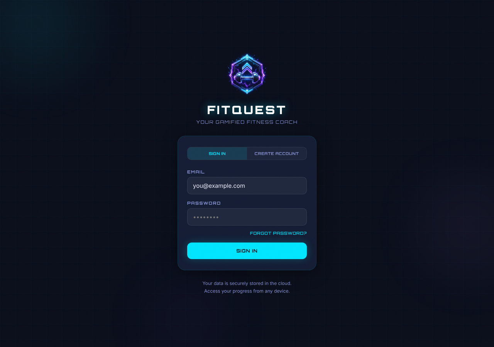

### TC-02
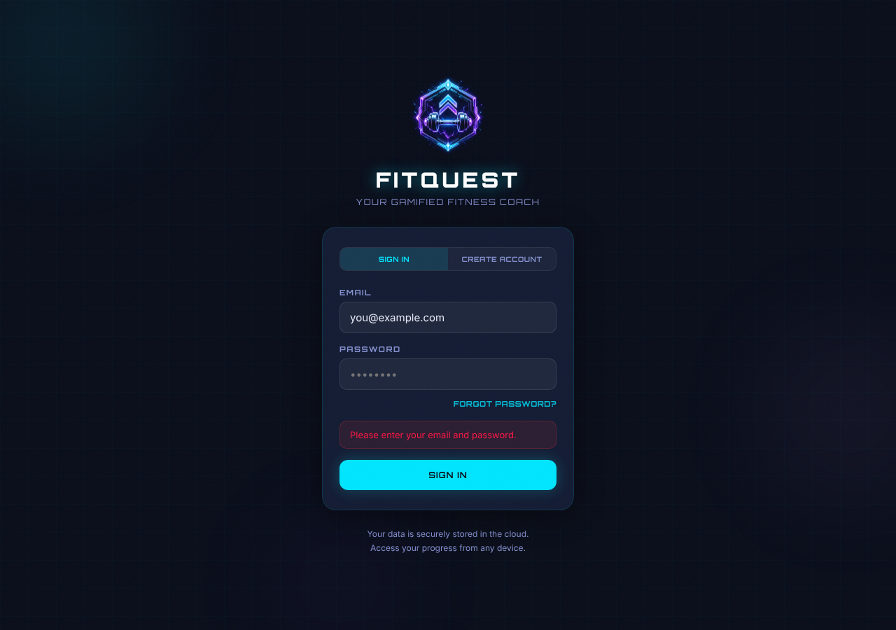
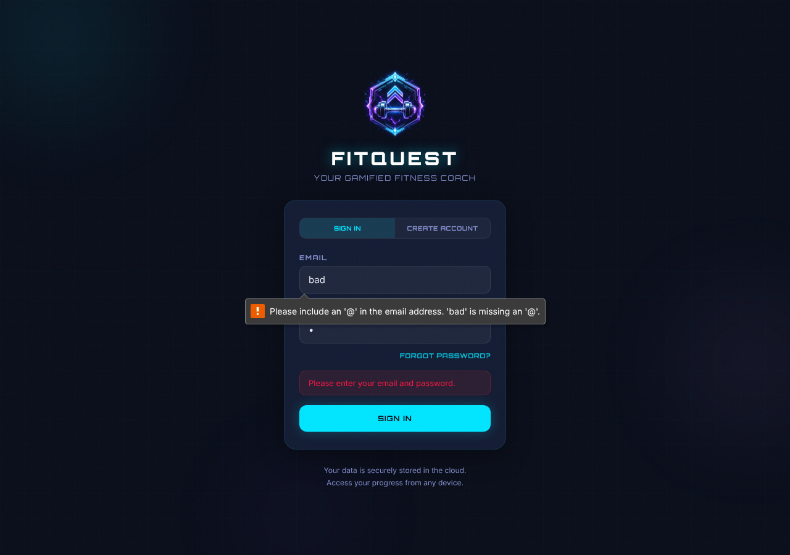

### TC-03
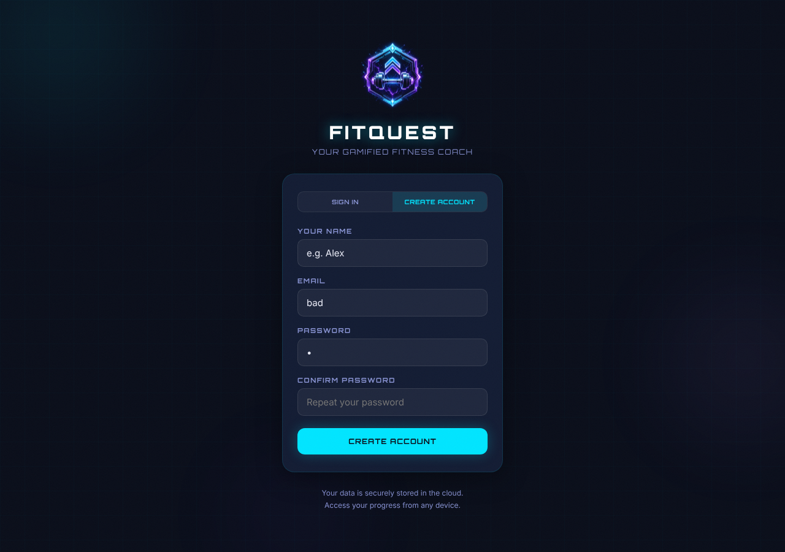
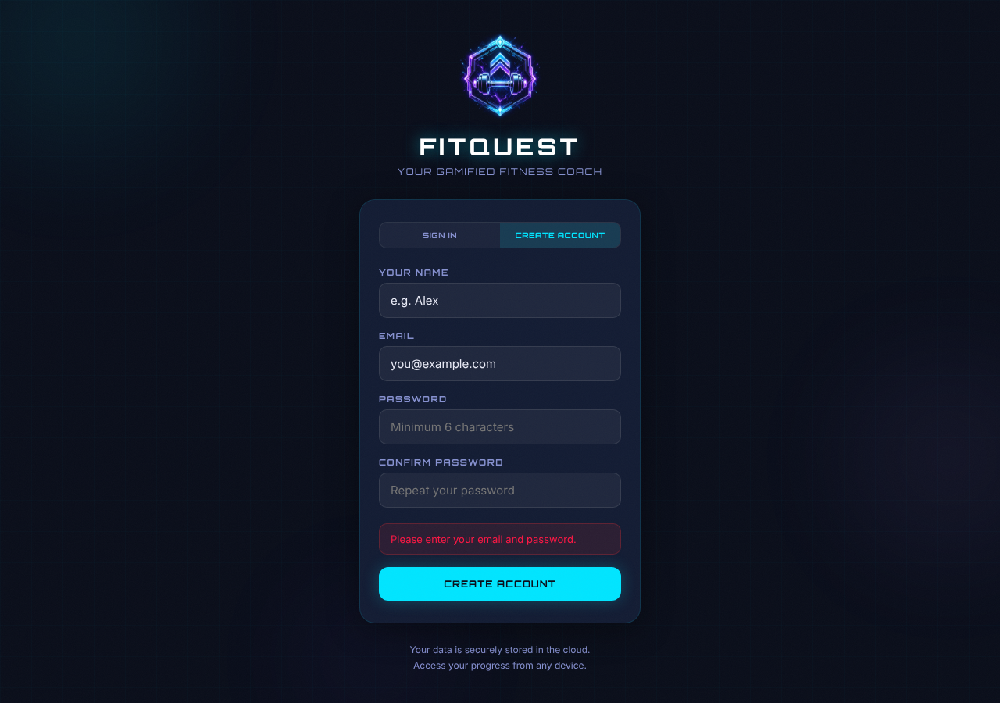
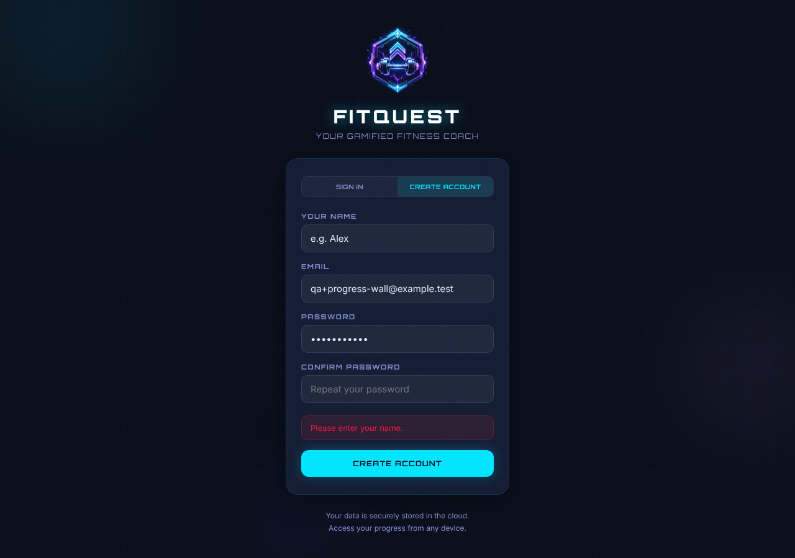
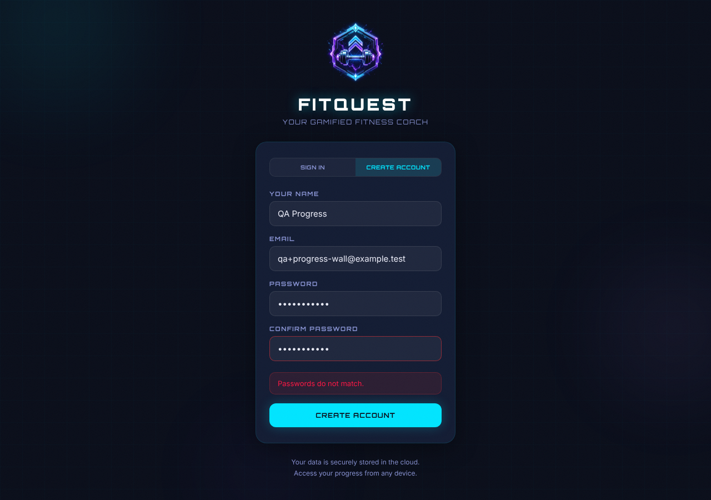
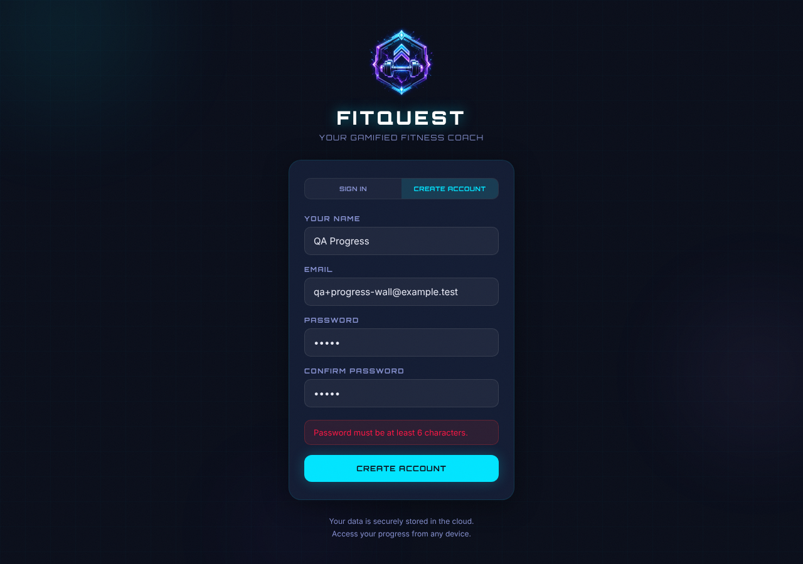

### TC-04
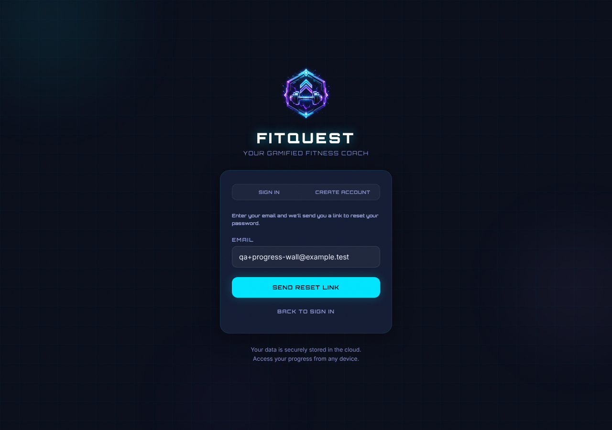
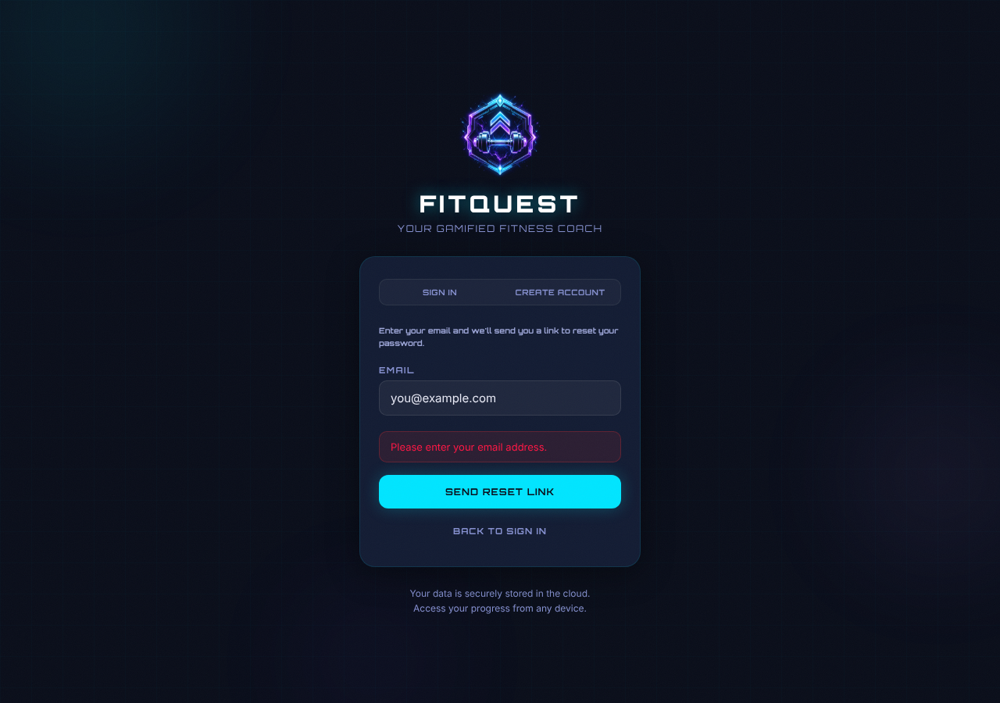
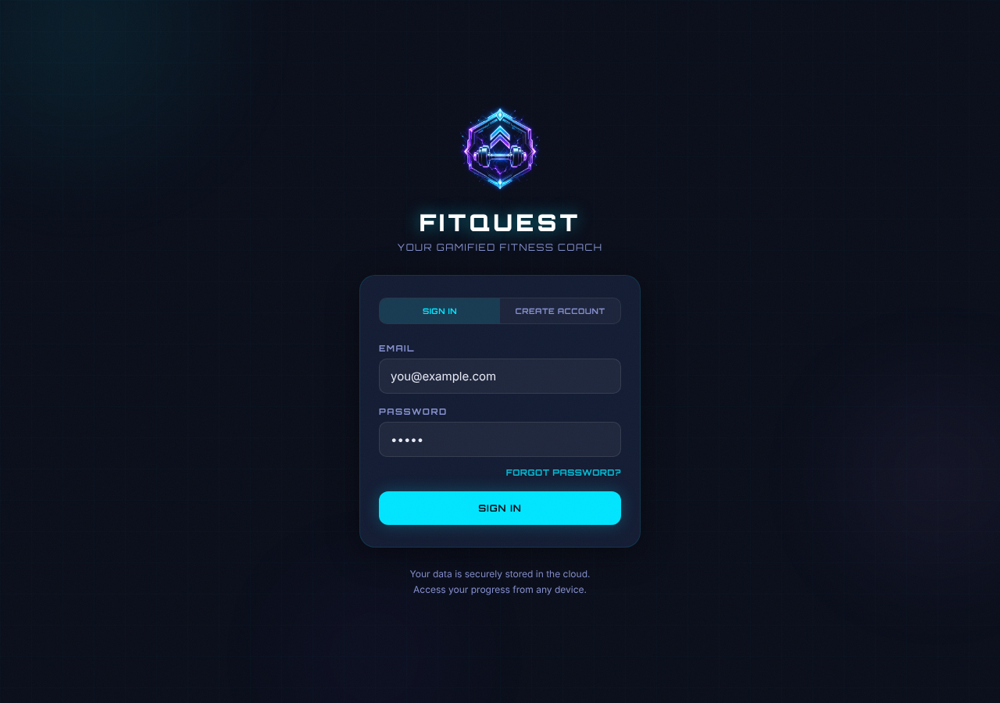

### TC-05
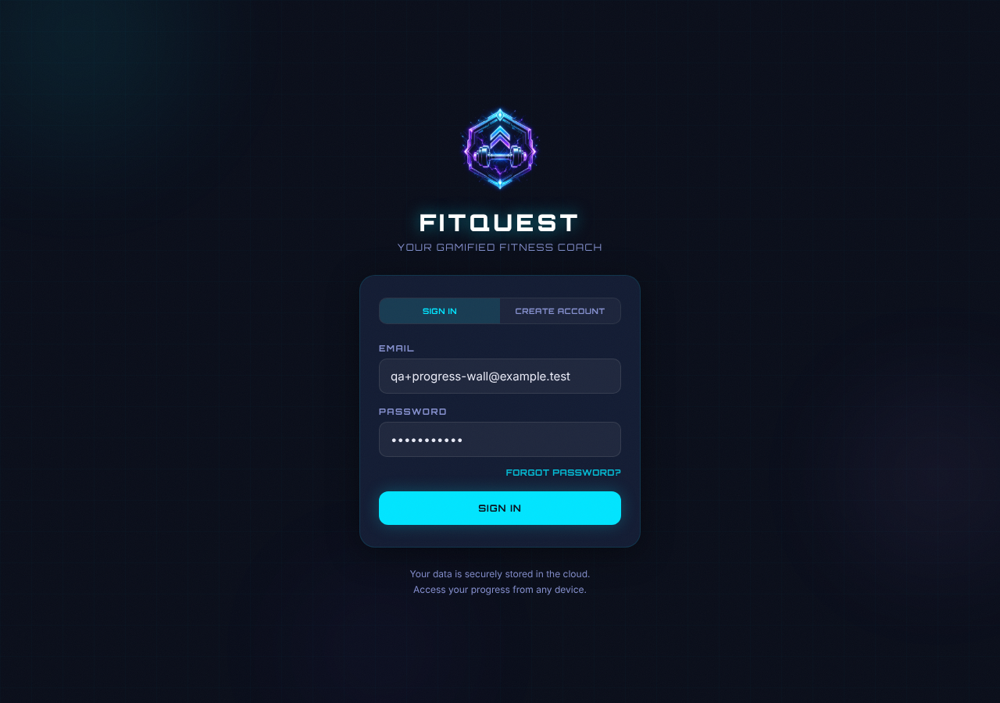
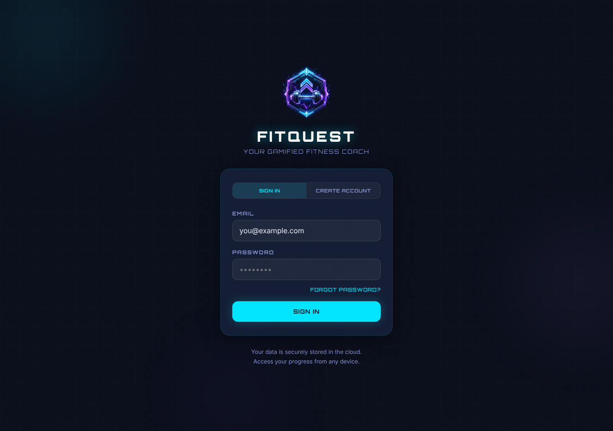

## Console & Network
- console.errors: []
- console.warnings: [src/lib/supabaseClient.js:6 — [FitQuest] Missing VITE_SUPABASE_URL or VITE_SUPABASE_ANON_KEY — cloud sync disabled (x2, expected)]
- failedRequests: []

## Defects Found
- None. Observation (known, documented in the task, not counted as a failure): with no Supabase env, a well-formed SIGN IN gives no user feedback (silent failure).
