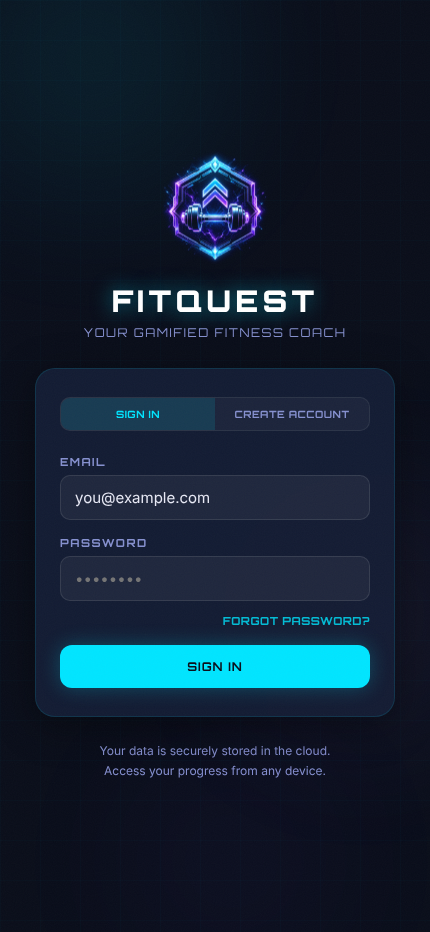
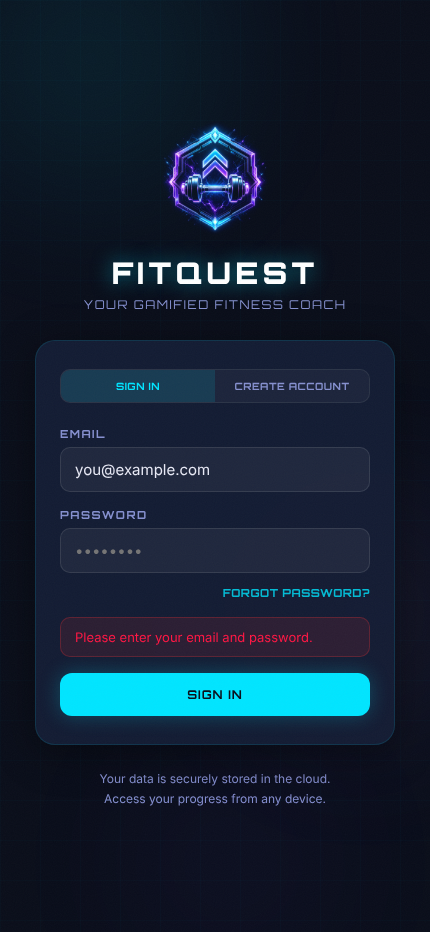
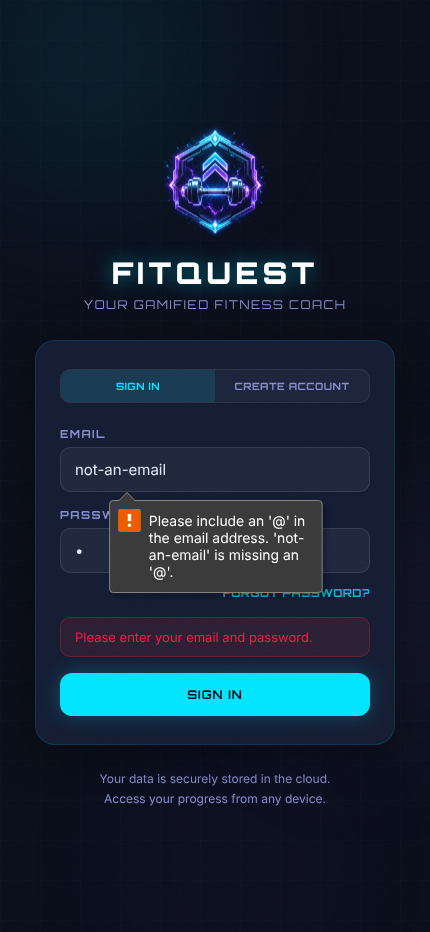
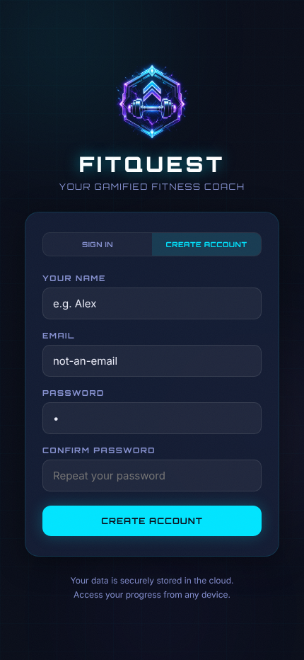
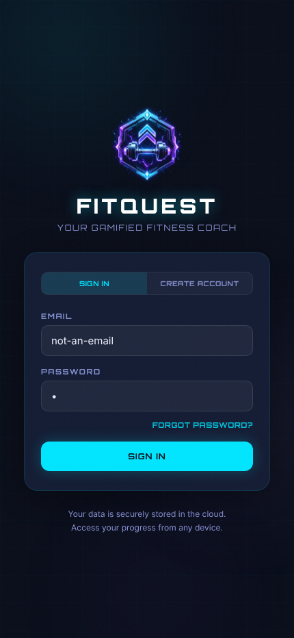
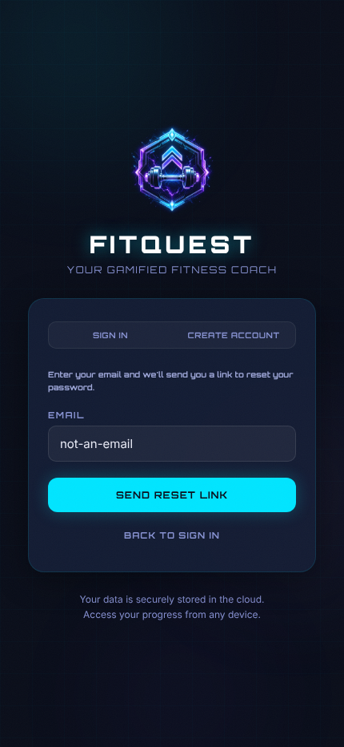
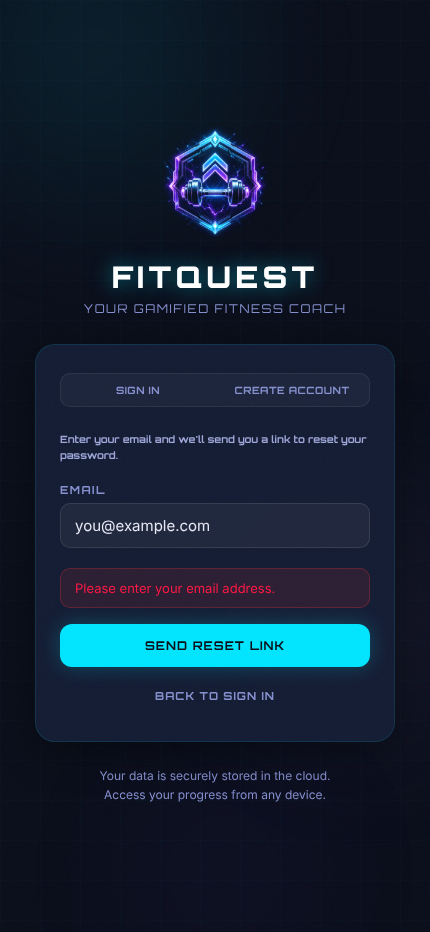
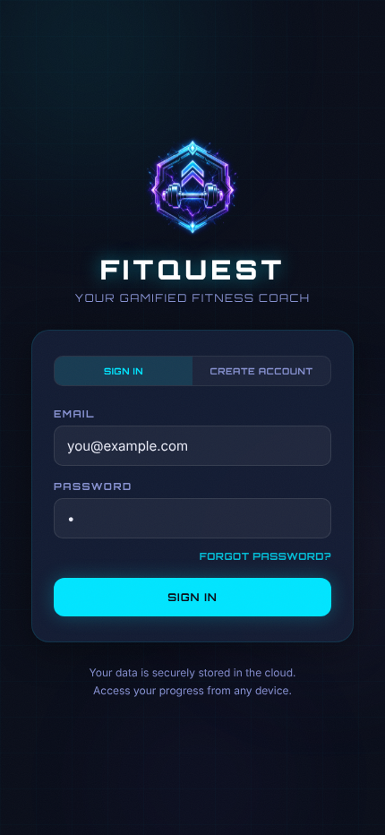
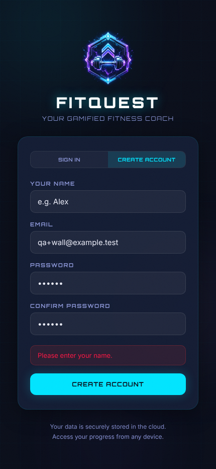
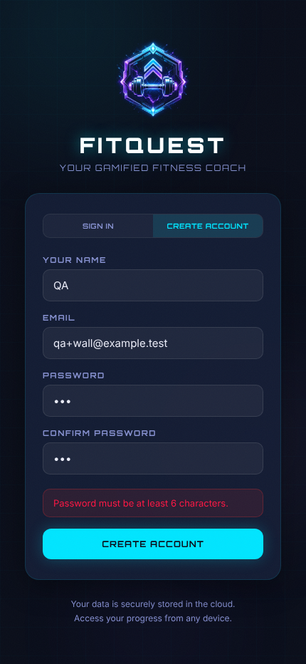

# T40-profile-auth-wall-anonymous: Anonymous visit to the Profile deep link shows the login wall — Result

| Field | Value |
|---|---|
| Result | PASS |
| Task file | QA-tests/tasks/T40-profile-auth-wall-anonymous.md |
| Route | /?tab=profile |
| Date (UTC) | 2026-10-24T03:23:43Z |
| Run id | 2026-10-24T03-20-29Z |
| Duration (s) | 16 |
| Role | anonymous |
| Browser engine | playwright |
| Browser channel | chromium |
| Headless | true |
| Screenshots | 14 |
| Console errors | 0 |
| Network failures | 0 |

## Summary
Attempt 2. The test was driven with the Node `playwright` library (chromium, headless, fresh context with no storage, 430x932 viewport, 1000 ms settle) against the dev server with no Supabase configured. An anonymous visit to `/?tab=profile` renders LoginScreen in place of the app shell. The URL and title stay unchanged, and no Profile, Header or tab-bar content is rendered. Every client-side validator in TC-02, TC-03 and TC-04 showed the documented message, and none sent a request to `/auth/v1/`. `/?tab=admin` and `/?tab=PROFILE` also render the login wall with the URL kept. There were no console errors and no failed requests. The only warning was the expected missing-Supabase-env warning. As the task expects, the stale inline error is still visible after native email validation blocks the submit. It is reported as a defect, not a test failure. No signup or sign-in was ever submitted with fully valid data, as the task instructs.

## Test Case Results

### TC-01: Happy path — deep link is held behind the login wall — PASS
- Step 1: Navigated to `http://localhost:5173/?tab=profile` in a fresh context.
- Step 2: Waited 1000 ms.
- Step 3: Final URL `http://localhost:5173/?tab=profile`, so there was no redirect and the query was kept.
- Step 4: Title `FitQuest — AI-Powered Fitness Training`.
- Step 5: Buttons in order: `SIGN IN`, `CREATE ACCOUNT` (toggles), `FORGOT PASSWORD?`, `SIGN IN` (submit). There is one `input[type=email]` with placeholder `you@example.com` under the label `EMAIL`, and one `input[type=password]` with placeholder `••••••••` under the label `PASSWORD`.
- Step 6: Body text is only `FITQUEST / YOUR GAMIFIED FITNESS COACH / SIGN IN / CREATE ACCOUNT / EMAIL / PASSWORD / FORGOT PASSWORD? / SIGN IN / Your data is securely stored in the cloud. / Access your progress from any device.` None of `Warrior Rank`, `My Program`, `Achievements`, `Settings`, `Train`, `Fuel`, `Progress` or `Profile` appear, and there is no `header` or `nav` element.
- Step 7: The console had 0 errors. The only warning was `[FitQuest] Missing VITE_SUPABASE_URL or VITE_SUPABASE_ANON_KEY — cloud sync disabled`, plus Vite and React DevTools debug/info lines.
- Assertion: login wall in place of the app shell with the URL unchanged → actual: as expected.

### TC-02: Form validation — login wall signin form — PASS
| Field | Case | Expected | Actual | Result |
|---|---|---|---|---|
| EMAIL + PASSWORD | both empty | "Please enter your email and password." (inline), URL unchanged | "Please enter your email and password." visible; URL `/?tab=profile` | ✓ |
| EMAIL | `not-an-email` (PASSWORD `x`) | native `type=email` constraint blocks submit; no `/auth/v1/` request | `input[type=email]:invalid` matched 1; validationMessage "Please include an '@' in the email address. 'not-an-email' is missing an '@'."; 0 auth requests | ✓ |
| (observation) | stale error after native block | earlier inline error still visible (known defect) | "Please enter your email and password." still visible below the native bubble | ✓ (defect recorded) |

### TC-03: Button coverage — PASS
| Button | Action | Expected | Actual | Result |
|---|---|---|---|---|
| CREATE ACCOUNT (toggle) | click | Signup fields, submit `CREATE ACCOUNT`, error cleared, URL unchanged | `YOUR NAME` (placeholder `e.g. Alex`, maxlength 30), `EMAIL`, `PASSWORD` (`Minimum 6 characters`), `CONFIRM PASSWORD` (`Repeat your password`). Submit `CREATE ACCOUNT`. Stale error gone. URL `/?tab=profile` | ✓ |
| SIGN IN (toggle) | click | Signin mode with EMAIL/PASSWORD, FORGOT PASSWORD?, submit SIGN IN | As expected | ✓ |
| FORGOT PASSWORD? | click | Forgot text, EMAIL, SEND RESET LINK, BACK TO SIGN IN | "Enter your email and we'll send you a link to reset your password.", the email field and both buttons are shown | ✓ |
| SEND RESET LINK | click with empty email | "Please enter your email address." | "Please enter your email address." visible, 0 auth requests | ✓ |
| BACK TO SIGN IN | click | Signin mode, error cleared | Submit `SIGN IN`, error gone | ✓ |

### TC-04: Negative & edge cases — PASS
- Signup with name `""`, email `qa+wall@example.test`, password and confirm `abcdef` → `Please enter your name.` is shown.
- Signup with name `QA`, password `abcdef`, confirm `abcdeg` → the confirm border turned `rgba(255, 50, 50, 0.5)` while typing, and submit showed `Passwords do not match.`
- Signup with name `QA`, password and confirm `abc` → `Password must be at least 6 characters.` is shown.
- None of the validator submits sent a request to `/auth/v1/`. No fully valid signup was submitted.
- `/?tab=admin` → the login wall renders (submit `SIGN IN`, no header/nav). The URL keeps `?tab=admin`, and there were no console errors (only the expected Supabase warning). After sign-in, `initialTabFromUrl` would fall back to `train`. This was not checked, because signing in is out of scope.
- `/?tab=PROFILE` → the login wall renders and the URL keeps `?tab=PROFILE`. The whitelist is case-sensitive, so this would open `train` after sign-in. This was not checked, because signing in is out of scope.

## Screenshots

### TC-01

### TC-02

### TC-03

### TC-04

## Console & Network
- console.errors: []
- console.warnings: [src/lib/supabaseClient.js:6 — [FitQuest] Missing VITE_SUPABASE_URL or VITE_SUPABASE_ANON_KEY — cloud sync disabled (once per page load, 3 loads; expected)]
- failedRequests: []

## Defects Found
- DEF-stale-login-error-native-validation: Stale login error persists when native email validation blocks submit. After an empty submit shows "Please enter your email and password.", typing an invalid email (`not-an-email`) and submitting leaves the old inline error on screen next to the browser's native validation bubble. `handleSubmit` never runs, so `localError` is never cleared (src/components/LoginScreen.jsx). This is an expected finding, not a test failure.
